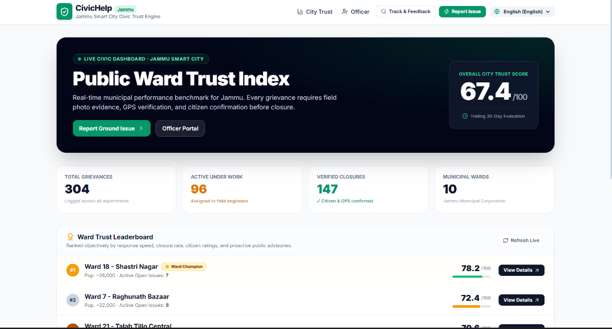
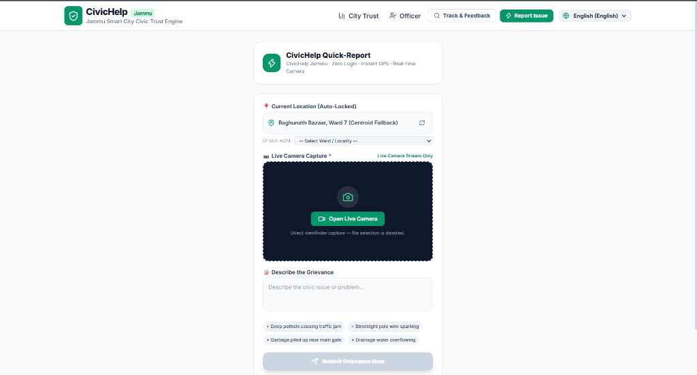
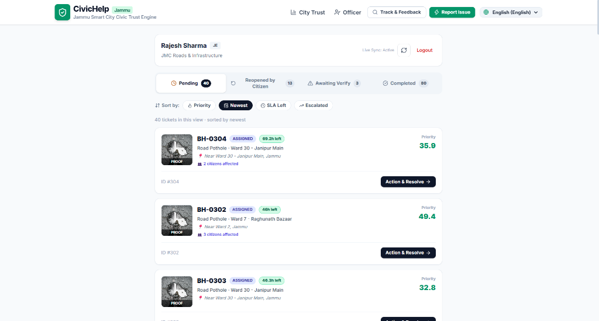
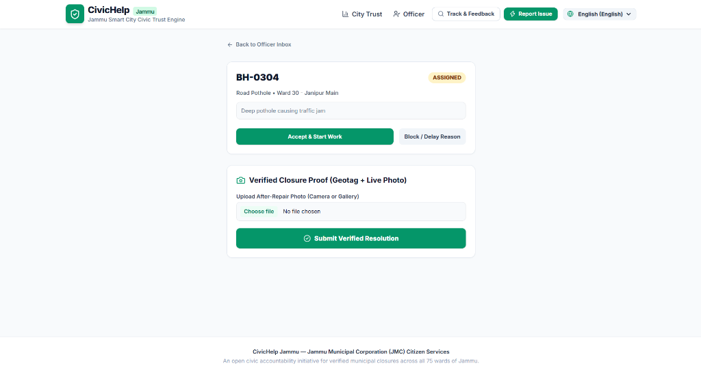
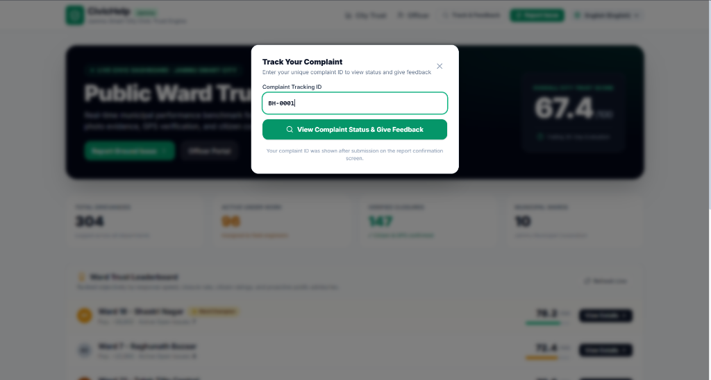
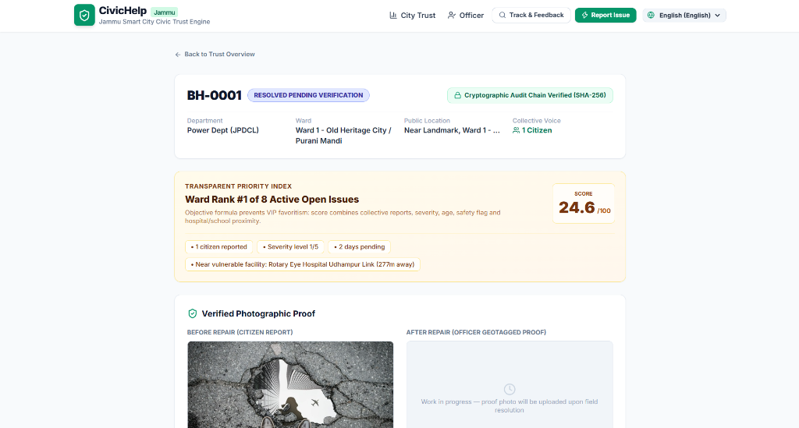
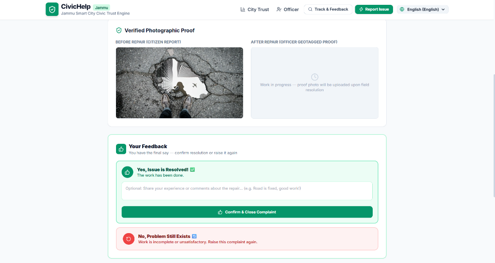
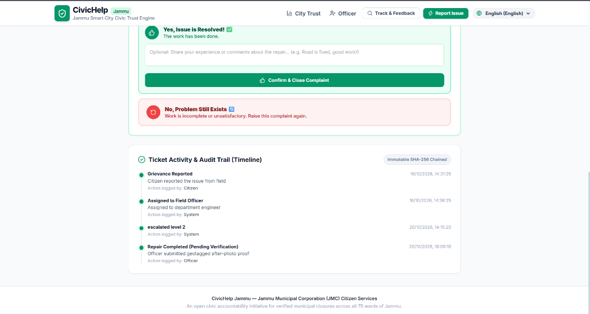

# CivicHelp Jammu (सिविक हेल्प जम्मू)
> **A Verifiable Civic Trust & Accountability Engine for Jammu Municipal Corporation (JMC)**  
> *Category 05: Welfare for All | Problem Statement: Strengthen Citizen-Municipality Trust through Communication, Responsive Services, Participation, and Feedback Mechanisms.*

---

## 🏛️ Executive Summary

Traditional municipal grievance portals fail on the ground due to a fundamental breakdown of accountability:
1. **Paper/Ghost Closures:** Field tickets are frequently marked "Resolved" without physical inspections.
2. **Duplicate Noise & Clutter:** Neighbors reporting the same broken road create 10 redundant tickets that choke officer queues.
3. **No Verifiable Ground Truth:** Complainants upload random stock photos while officers resolve tickets from distant desks.
4. **Zero Citizen Authority:** The municipality unilaterally decides when an issue is closed, leaving citizens helpless if the problem persists.

**CivicHelp Jammu** turns grievance management into a closed-loop civic accountability operating system:
- **Zero-Login Quick Reporting:** In-browser live camera viewfinder with auto-locked GPS — strictly blocking internet/gallery photo spam.
- **Collective Voice (AI Spatial Clustering):** Automatically merges nearby duplicate reports ($\le 60\text{m}$) into a single high-priority ticket with elevated citizen weight.
- **Real-Time Officer Sync:** Live background sync alerts field officers instantly with the citizen's photo proof visible directly on dashboard cards.
- **Two-Way Citizen Verification:** No ticket can permanently close without the reporting citizen's confirmation and written feedback. Unsatisfied citizens can reopen tickets with a single click.
- **Multi-Lingual Regional Access:** Instant one-click translation into regional languages (**English, हिन्दी, डोगरी, اردو, ਪੰਜਾਬੀ, کٲشُر**).
- **Automated SLA Hierarchy Escalation:** Time-bound resolution counters trigger automated escalation: Junior Engineer $\rightarrow$ Executive Engineer $\rightarrow$ Municipal Commissioner.

---

## 📸 Visual Tour & Walkthrough

Here is a visual walkthrough of the platform across both citizen and municipal officer workflows:

### 1. 🌐 Public City Trust Portal (`/`)
*Real-time municipal health dashboard showing overall City Trust Score (67.4/100), total active vs verified closures, and competitive ward-by-ward rankings (e.g. Ward 18 Shastri Nagar as Ward Champion).*


---

### 2. 🌍 Regional Linguistic Accessibility
*One-click multi-language switcher supporting English, Hindi, Dogri, Urdu, Punjabi, and Kashmiri to eliminate language barriers for citizens across Jammu & Kashmir.*


---

### 3. 🏛️ Full Dogri Real-Time Localization
*The entire platform dynamically translated into Dogri (पब्लिक वार्ड ट्रस्ट सूचकांक, सिविकहेल्प, रिपोर्ट मुद्दा), ensuring zero linguistic exclusion.*


---

### 4. 📸 Citizen Quick-Report with Live Camera Viewfinder (`/report`)
*Zero-login 30-second intake. Features auto-locked GPS with ward selector fallback, browser-enforced **Live Camera Only** viewfinder (gallery uploads strictly disabled to prevent recycled spam), and instant AI spatial clustering.*


---

### 5. ⚡ Officer Action Console with Citizen Photo Proof (`/officer`)
*Live officer inbox featuring citizen-submitted live photo proofs on every card, SLA countdown chips, citizen collective voice counts, and dedicated tabs: **Pending**, **Reopened by Citizen 🔄**, **Awaiting Verify**, and **Completed**.*


---

### 6. 🛠️ Officer Resolution Console (`/officer/t/[id]`)
*Officers accept grievances, initiate field crew dispatch, or declare transparent public delay reasons. Work closure requires uploading an after-repair photo proof.*


---

### 7. 🔍 Citizen Track & Feedback Navigation Modal
*One-click popup search accessible from any page via the top navigation bar. Citizens simply enter their unique tracking code (e.g. `BH-0001`) to jump directly to their grievance audit trail and feedback console.*


---

### 8. 📊 Public Grievance Tracker & Priority Index (`/t/BH-0001`)
*Public audit trail displaying cryptographic SHA-256 verification, Ward Rank #1 of 8 Active Open Issues, and an objective formula-based Transparent Priority Score (24.6/100) preventing VIP favoritism.*


---

### 9. 🔄 Verified Photographic Proof & Citizen Feedback Loop
*Before vs After visual comparison. The citizen holds the final authority over closure: they can confirm resolution with feedback comments or reject and reopen the complaint.*


---

### 10. ⛓️ Immutable SHA-256 Chained Audit Trail
*Every milestone (Grievance Reported → Assigned to Officer → Escalation → Repair Completed → Citizen Feedback) is cryptographically chained and publicly viewable.*


---

## 📱 Application Routes

| Route | Name | Purpose |
|---|---|---|
| `/` | **Public Trust Portal** | 75 Wards civic leaderboard, verified metrics, regional language switcher. |
| `/report` | **Citizen Quick-Report** | Zero-login 30s reporting via live camera stream + GPS auto-lock. |
| `/t/[code]` | **Citizen Tracking & Feedback** | Before/After visual comparison, audit trail, and citizen feedback (Confirm / Reopen). |
| `/officer` | **Officer Action Console** | Priority queue, real-time toast alerts, citizen photo thumbnails, Reopened tab. |
| `/officer/t/[id]` | **Resolution Console** | Upload after-repair proof, declare public delays, submit resolution. |
| `/admin` | **Commissioner HQ** | Department workloads, SLA breach escalation monitors, city-wide audit events. |
| `/ward/[id]` | **Ward Deep Dive** | 6-component municipal trust score breakdown and historical trends. |

---

## 🚀 Quick Setup & Run

### 1. Requirements
- Python 3.11+
- Node.js 18+ (tested on v20 & v22)
- Git

### 2. Run Backend (FastAPI)
```powershell
# In repository root
python -m uvicorn backend.app.main:app --host 0.0.0.0 --port 8000 --reload
```
API Documentation will be live at `http://localhost:8000/docs`.

### 3. Run Frontend (Next.js)
```powershell
cd frontend
npm install
npm run dev
```
Open **`http://localhost:3000`** in your browser.

---

## 🧪 Demo Data & Quick Testing
To demo the full feedback loop out of the box:
1. Open **`http://localhost:3000`**
2. Click **"Track & Feedback"** in the top navbar.
3. Enter Demo Ticket ID: **`BH-0001`**
4. Review Before & After repair photos and test the **Citizen Feedback** (Confirm Resolution or Reopen with comments).
5. Switch to **`http://localhost:3000/officer`** to see the **Reopened by Citizen** tab update live!

---

## 📄 License & Attribution
Developed for the **Jammu Smart City Hackathon** by **jaisoni-codes** (`jaisonix11@gmail.com`).  
*CivicHelp Jammu — An open civic trust and accountability initiative for Jammu Municipal Corporation (JMC).*
